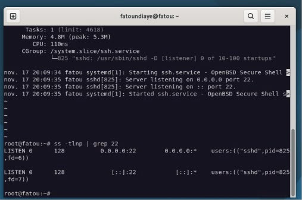
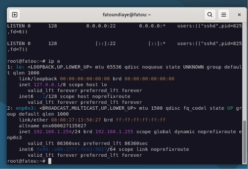
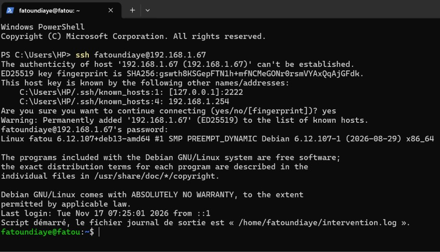
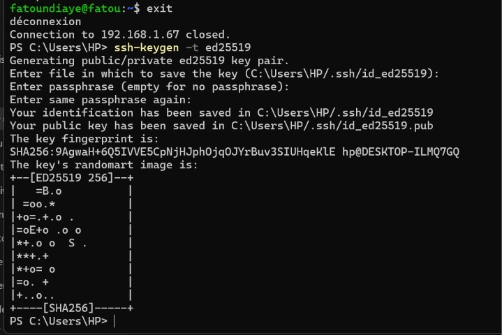
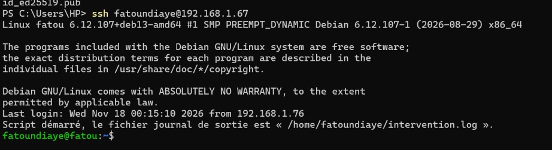
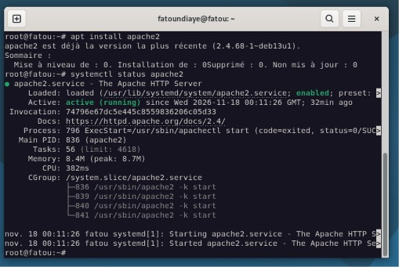
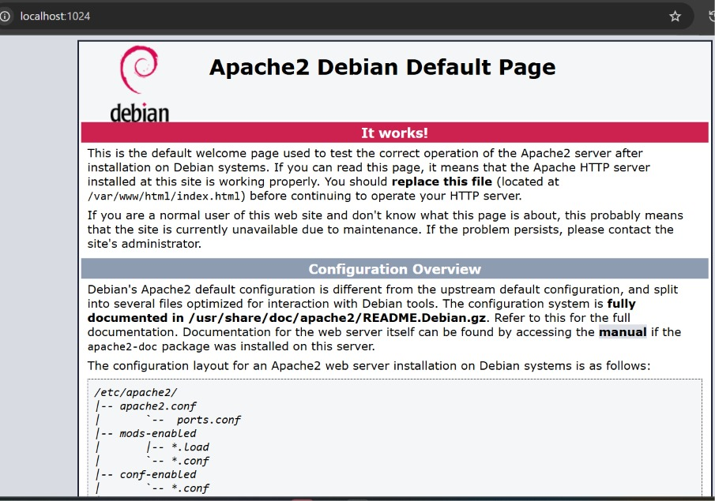
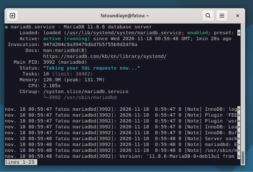
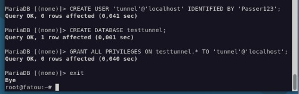
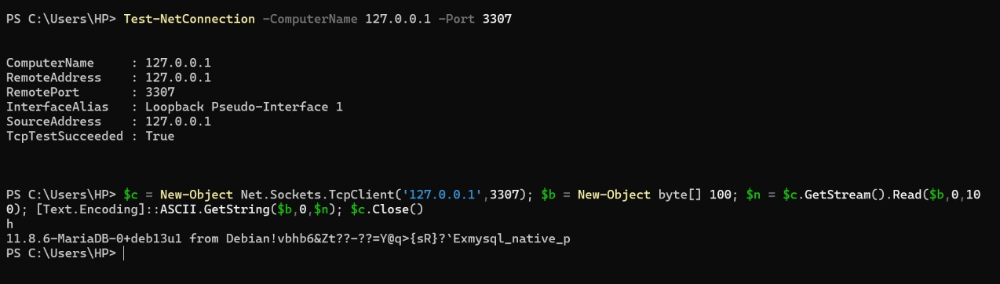

# Compte Rendu de TP : Mise en place du protocole SSH

* **Établissement :** DGI - École Supérieure Polytechnique (ESP) / UCAD
* **Formation :** Licence 3 – Génie Logiciel et Systèmes d'Information (L3 GLSI)
* **Année académique :** 2026-2027
* **Module :** Services Réseaux Avancés
* **Professeur :** Dr. GUEYE
* **Réalisé par :** Fatou NDIAYE & Seynabou SOW

---

## Introduction

Dans le cadre du module **Services Réseaux Avancés**, ce travail pratique a pour objectif de mettre en œuvre le protocole **SSH (*Secure Shell*)** afin de sécuriser l'administration à distance d'une machine serveur Linux depuis un poste client. Nous avons ainsi expérimenté l'installation du service, l'authentification classique par mot de passe, le renforcement de la sécurité par échange de clés asymétriques, ainsi que la création de tunnels chiffrés pour le transit de flux HTTP et SQL.

* **Machine serveur :** Système Linux Debian 13 (machine virtuelle `fatou`, utilisateur `fatoundiaye`), adresses IP attribuées `192.168.1.254` / `192.168.1.67`.
* **Machine cliente :** Poste physique sous Windows (`DESKTOP-ILMQ7GQ`), session PowerShell `C:\Users\HP` (adresse IP `192.168.1.76`).

---

## I. Installation et vérification du service SSH

Dans un premier temps, nous avons préparé notre machine serveur Linux Debian en mettant à jour la liste des paquets et en installant le serveur OpenSSH. Nous avons ensuite activé le démon au démarrage du système et démarré le service afin qu'il soit immédiatement opérationnel :

```bash
sudo apt update
sudo apt install openssh-server
sudo systemctl enable ssh
sudo systemctl start ssh
```

Afin de nous assurer que le serveur SSH fonctionne correctement et qu'il écoute bien sur le port TCP par défaut (le port `22`), nous avons vérifié l'état du service avec `systemctl status ssh`, puis contrôlé l'ouverture du port réseau à l'aide de la commande `ss -tlnp | grep 22` (équivalent moderne de `netstat` sous Debian).



*Figure 1 : Vérification de l'activité du service `ssh.service` et écoute du démon `sshd` sur le port 22.*

Ensuite, nous avons relevé la configuration réseau de notre serveur en saisissant la commande `ip a`. Comme illustré sur la capture suivante, l'interface réseau `enp0s3` est bien active et dispose de l'adresse IPv4 attribuée sur notre réseau local.



*Figure 2 : Identification de l'adresse IP de l'interface réseau du serveur via la commande `ip a`.*

---

## II. Connexion SSH depuis le client

Une fois le serveur configuré, nous sommes passés sur le poste client sous Windows. Depuis l'invite de commandes PowerShell, nous avons initié une connexion distante vers le compte utilisateur du serveur en saisissant la commande suivante :

```powershell
ssh fatoundiaye@192.168.1.67
```

Lors de cette première tentative de connexion, le client SSH nous a demandé de confirmer l'authenticité de l'hôte distant en affichant l'empreinte de sa clé publique ED25519. Nous avons validé en saisissant `yes`, ce qui a automatiquement enregistré le serveur dans le fichier `known_hosts` du client. Après avoir saisi le mot de passe de l'utilisateur `fatoundiaye`, nous avons obtenu un accès direct au terminal de la machine Debian.



*Figure 3 : Validation de l'empreinte du serveur et ouverture de la session SSH par mot de passe depuis Windows.*

---

## III. Configuration des clés SSH

L'authentification par mot de passe étant vulnérable aux attaques par force brute, nous avons mis en place une authentification forte par paire de clés cryptographiques asymétriques. Nous avons d'abord quitté la session distante avec `exit`, puis généré une paire de clés de type `ed25519` sur notre poste client à l'aide de la commande `ssh-keygen` :

```powershell
exit
ssh-keygen -t ed25519
```

> **Note méthodologique :** Dans une architecture où le poste Windows joue le rôle de client et la machine Linux celui de serveur, la paire de clés est générée sur le client Windows (`C:\Users\HP\.ssh\id_ed25519` et `id_ed25519.pub`), puis la clé publique est transférée et ajoutée dans le fichier `~/.ssh/authorized_keys` du serveur Linux.



*Figure 4 : Déconnexion et génération de la paire de clés publique/privée ED25519 sur le client Windows.*

Après avoir copié le contenu de notre clé publique `id_ed25519.pub` dans le fichier `~/.ssh/authorized_keys` du serveur Debian, nous avons relancé la commande de connexion `ssh fatoundiaye@192.168.1.67`. Comme le montre la capture ci-dessous, l'accès au shell du serveur s'est effectué instantanément sans qu'aucun mot de passe ne soit demandé.



*Figure 5 : Test de connectivité réussi par échange de clés asymétriques sans saisie de mot de passe.*

---

## IV. Tunnel SSH en ligne de commande

Dans cette dernière partie, nous avons exploité la fonctionnalité de redirection de ports locaux (*Local Port Forwarding*) du protocole SSH. Le principe consiste à encapsuler et chiffrer le trafic d'autres protocoles applicatifs (tels que HTTP ou MariaDB) à l'intérieur d'un tunnel SSH sécurisé.

### 1. Test avec le serveur Web (Apache2)

Sur le serveur Linux, nous avons installé et vérifié le bon fonctionnement du serveur HTTP **Apache2** (qui écoute par défaut sur le port `80`) à l'aide des commandes suivantes :

```bash
apt install apache2
systemctl status apache2
```



*Figure 6 : Installation et vérification de l'état actif (`running`) du serveur web Apache2 sur Debian.*

Depuis le poste client Windows, nous avons ensuite ouvert un tunnel SSH redirigeant notre port local `1024` vers le port `80` de la boucle locale du serveur distant grâce à l'option `-L` :

```powershell
ssh -L 1024:127.0.0.1:80 fatoundiaye@192.168.1.67
```

Pour valider le fonctionnement du tunnel, nous avons ouvert un navigateur web sur le poste client et saisi l'adresse `http://localhost:1024`. La page d'accueil par défaut d'Apache2 hébergée sur la machine Debian s'est affichée correctement, prouvant que le flux HTTP transitait bien à travers le tunnel SSH.



*Figure 7 : Accès au serveur web Apache2 distant depuis le navigateur client via `http://localhost:1024`.*

### 2. Test avec le serveur de base de données (MariaDB)

Nous avons reproduit la même démarche pour sécuriser l'accès au système de gestion de base de données **MariaDB** installé sur le serveur Linux (port par défaut `3306`). Nous avons d'abord contrôlé que le service était bien démarré :

```bash
systemctl status mariadb
```



*Figure 8 : Vérification de l'état d'exécution du serveur de base de données MariaDB sur le serveur.*

Nous avons ensuite accédé au moniteur SQL de MariaDB afin de créer un utilisateur dédié (`'tunnel'@'localhost'`), une base de données de test (`testtunnel`) et lui attribuer les privilèges nécessaires :

```sql
CREATE USER 'tunnel'@'localhost' IDENTIFIED BY 'Passer123';
CREATE DATABASE testtunnel;
GRANT ALL PRIVILEGES ON testtunnel.* TO 'tunnel'@'localhost';
exit
```



*Figure 9 : Création de l'utilisateur `tunnel` et de la base de données `testtunnel` sous MariaDB.*

Nous avons enfin établi un second tunnel SSH depuis Windows pour rediriger le port local `3307` vers le port `3306` du serveur Debian, puis vérifié l'ouverture du port local et lu la bannière du serveur MariaDB via PowerShell :

```powershell
ssh -L 3307:127.0.0.1:3306 fatoundiaye@192.168.1.67
Test-NetConnection -ComputerName 127.0.0.1 -Port 3307
```

Le test réseau a retourné `TcpTestSucceeded : True` et l'interrogation du socket sur `127.0.0.1:3307` nous a renvoyé la bannière de version `11.8.6-MariaDB`, confirmant la réussite de l'encapsulation du trafic SQL.


*Figure 10 : Validation de la connectivité TCP sur le port local 3307 et réception de la bannière MariaDB.*

---

## Conclusion

Ce travail pratique nous a permis de maîtriser le déploiement et la sécurisation d'un serveur OpenSSH sous Linux. Nous avons pu constater l'intérêt de l'authentification par paire de clés cryptographiques pour éliminer l'usage des mots de passe, ainsi que l'efficacité du tunneling SSH (redirection de ports locaux) pour chiffrer des communications applicatives sensibles comme HTTP et MariaDB sans exposer directement leurs ports sur le réseau.
